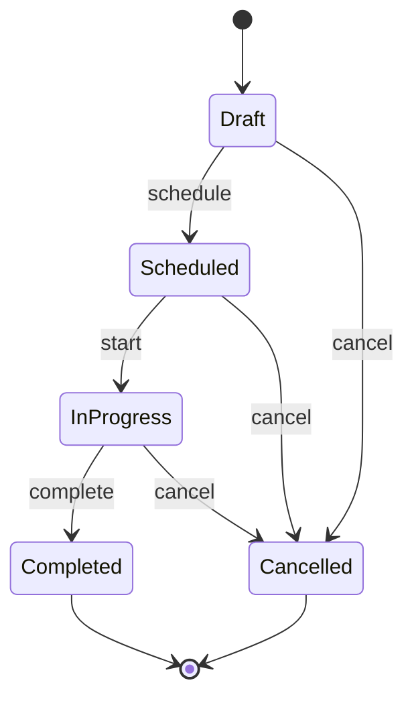
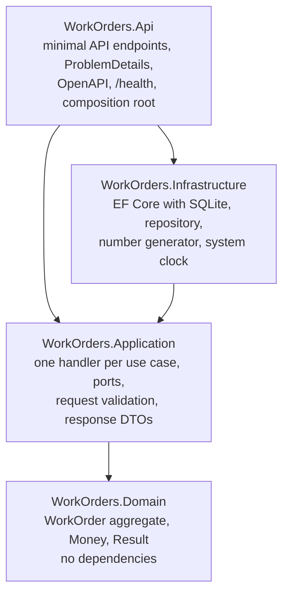

# Work orders: a Clean Architecture sample in .NET 10

A small back end for field service work orders. A customer reports a problem, a technician is
scheduled, time and materials are logged on site, and the job is completed or cancelled.

I wrote this as a code sample for clients who want to see how I build a .NET service before
they hire me. It is deliberately small, but complete: the business rules sit in a domain model
without framework code, each use case has its own handler, the database sits behind interfaces,
and every rule has a test. The build treats every warning as an error, and CI checks build,
tests and formatting on every push.

Where to look, depending on your time:

- **5 minutes**: the aggregate [`WorkOrder.cs`](src/WorkOrders.Domain/WorkOrder.cs) and its
  tests in [`tests/WorkOrders.Domain.Tests`](tests/WorkOrders.Domain.Tests).
- **15 minutes**: one use case from HTTP to database: the schedule endpoint in
  [`WorkOrderEndpoints.cs`](src/WorkOrders.Api/Endpoints/WorkOrderEndpoints.cs), then
  [`ScheduleWorkOrder.cs`](src/WorkOrders.Application/UseCases/ScheduleWorkOrder.cs),
  `WorkOrder.Schedule`, and the EF Core mapping in
  [`WorkOrderConfiguration.cs`](src/WorkOrders.Infrastructure/Persistence/Configurations/WorkOrderConfiguration.cs).
- **30 minutes**: clone it, run `dotnet test`, start the API and try the calls under
  [Try the API](#try-the-api).

## The domain



A work order has a number (`WO-2026-0001`, a new sequence each year), a customer, a site and a
problem description, an hourly rate, a status, a scheduled date with an assigned technician, time
entries (technician, date, minutes) and material lines (description, quantity, unit price).

| Rule | Enforced in | Tested in |
| --- | --- | --- |
| Only the transitions in the diagram above are allowed | [`WorkOrderLifecycle.cs`](src/WorkOrders.Domain/WorkOrderLifecycle.cs) | `WorkOrderLifecycleTests` (all 25 status pairs) |
| Scheduling needs a technician and a date that is not in the past; "today" comes from an injected clock | `WorkOrder.Schedule` | `WorkOrderSchedulingTests`, `StatusHandlerTests` |
| Work can only start from Scheduled | `WorkOrder.Start` | `WorkOrderExecutionTests` |
| Time and materials only while InProgress; minutes and quantity must be positive | `WorkOrder.LogTime`, `WorkOrder.AddMaterial` | `WorkOrderExecutionTests` |
| Complete only from InProgress, with at least one time entry | `WorkOrder.Complete` | `WorkOrderClosingTests` |
| Completed and cancelled work orders cannot change | `WorkOrder` (checked before every change) | `WorkOrderClosingTests` (every change on both closed statuses) |
| Total = labour (minutes × hourly rate) + materials, in euros, rounded to cents, never negative | `WorkOrder.Total`, [`Money.cs`](src/WorkOrders.Domain/Common/Money.cs) | `WorkOrderTotalsTests`, `MoneyTests` |

Labour is rounded once over all minutes, not per time entry: three entries of 20 minutes at
€65.00 an hour cost €65.00, not 3 × €21.67 = €65.01.

## Architecture



The arrows are project references, and they all point inward. The application layer defines the
interfaces it needs (ports); the infrastructure layer implements them. The API references
infrastructure only in [`Program.cs`](src/WorkOrders.Api/Program.cs), to register it; the
endpoints only know the application handlers.

```text
src/
  WorkOrders.Domain/           aggregate, value objects, Result and Error; no package references
  WorkOrders.Application/      handlers, ports, request validation, response DTOs
  WorkOrders.Infrastructure/   EF Core mapping, repository, number generator, clock, DI registration
  WorkOrders.Api/              endpoints, problem details, OpenAPI, health check, composition root
tests/
  WorkOrders.Domain.Tests/       unit tests of the business rules
  WorkOrders.Application.Tests/  handler tests with hand-written fakes
  WorkOrders.Api.Tests/          HTTP tests with WebApplicationFactory and in-memory SQLite
```

## SOLID in this codebase

**Single responsibility.** Each use case is one file with one command and one handler, for example
[`ScheduleWorkOrder.cs`](src/WorkOrders.Application/UseCases/ScheduleWorkOrder.cs). Endpoints
translate HTTP into commands and results into HTTP, and nothing else
([`WorkOrderEndpoints.cs`](src/WorkOrders.Api/Endpoints/WorkOrderEndpoints.cs)). Mapping errors to
status codes happens in one place ([`ProblemResults.cs`](src/WorkOrders.Api/Endpoints/ProblemResults.cs)),
and so does mapping the domain to response DTOs
([`WorkOrderMapping.cs`](src/WorkOrders.Application/UseCases/WorkOrderMapping.cs)).

**Open/closed.** `ProblemResults.ToProblem` maps an error by its `ErrorType`, not by its code. A new
domain error, such as `WorkOrderErrors.NoTimeLogged`, gets the right status code without a change in
the API. A new use case is a new file, one line in
[`AddApplication`](src/WorkOrders.Application/DependencyInjection.cs) and one endpoint; existing
handlers stay as they are.

**Liskov substitution.** The handlers run unchanged against EF Core in the API and against
in-memory fakes in the tests ([`tests/WorkOrders.Application.Tests/Fakes`](tests/WorkOrders.Application.Tests/Fakes)).
The fakes keep the contract of the real implementations: the repository returns `null` for an
unknown id and lists by number, and the number generator counts per year. `ValidationError` is an
`Error` with field details; handlers return it like any other error.

**Interface segregation.** The ports in
[`src/WorkOrders.Application/Abstractions`](src/WorkOrders.Application/Abstractions) are small:
`IClock` has one property, `IUnitOfWork` and `IWorkOrderNumberGenerator` one method each,
`IWorkOrderRepository` three. Each handler asks only for what it uses: `GetWorkOrderHandler` takes
just the repository, and only the create and schedule handlers get a clock.

**Dependency inversion.** The application layer owns the ports; infrastructure implements them
([`WorkOrderRepository.cs`](src/WorkOrders.Infrastructure/Persistence/WorkOrderRepository.cs),
[`SystemClock.cs`](src/WorkOrders.Infrastructure/Time/SystemClock.cs)), and only the composition
root in [`Program.cs`](src/WorkOrders.Api/Program.cs) connects the two. The domain does not even
depend on a clock interface: `WorkOrder.Schedule(technician, scheduledDate, today)` gets today's
date from the handler, so the rule depends only on its inputs.

## Design decisions

### Plain handlers instead of MediatR

Each endpoint gets its handler from dependency injection and calls `HandleAsync` directly. There
is no dispatcher in between, so "go to definition" on the endpoint leads straight to the code that
runs, and the handler's dependencies are visible in its constructor. MediatR and AutoMapper moved
to commercial licences in 2025, which is one more reason to keep them out of a sample that anyone
should be able to copy; the response mapping in `WorkOrderMapping.cs` is written by hand.

The trade-off: there are no pipeline behaviours for cross-cutting concerns. Validation is an
explicit first step in each handler. If the service grew, a decorator registered in DI or an
endpoint filter could add logging or transactions without a library.

### A Result type for expected failures

An invalid field or a wrong status is part of normal operation, not an exceptional event. Methods
that can fail that way return `Result` or `Result<T>`
([`Result.cs`](src/WorkOrders.Domain/Common/Result.cs)), so the failure is visible in the signature
and the caller has to handle it. Every error has a stable code, and the API maps the error type to
an [RFC 9457](https://www.rfc-editor.org/rfc/rfc9457) problem response:

| Error type | Status | Codes |
| --- | --- | --- |
| Validation | 400 | `Request.Invalid` (with an `errors` member per field), `WorkOrder.ScheduledDateInPast` |
| Not found | 404 | `WorkOrder.NotFound` |
| Conflict | 409 | `WorkOrder.InvalidStatusTransition`, `WorkOrder.NotInProgress`, `WorkOrder.NoTimeLogged`, `WorkOrder.Closed` |

Clients can branch on `code` instead of parsing the text. Malformed JSON, or a body with a missing
field, is also a 400. Exceptions are left for bugs and infrastructure failures; the exception
handler turns them into a 500 problem response.

State changes are separate actions (`POST /work-orders/{id}/start`) instead of a `PATCH` on the
status field. Each transition has its own rules, request body and error codes, and the endpoints
say what a client can do.

### SQLite

There is no database server to install: the API creates the database file on first start. The API
tests run on SQLite in memory with the real EF Core mapping, so a mapping mistake fails a test. The
EF Core in-memory provider would not catch that, because it is not a relational database. The
schema is created with `EnsureCreated` instead of migrations, which is fine for a sample and the
first thing I would change.

### What I would change for production

- **PostgreSQL**, with EF Core migrations applied by the deployment pipeline instead of `EnsureCreated`.
- **Work order numbers** from a database sequence per year. The counter table used now has a
  concurrency token and the number column a unique index, so two simultaneous creates cannot store
  the same number, but the second request fails with a 500 instead of retrying.
- **Optimistic concurrency** on the work order itself (a version column), so two people changing
  the same work order cannot overwrite each other's change.
- **A transactional outbox** for integration events such as "work order completed" (for
  invoicing): the event is stored in the same transaction as the state change and published after
  the commit.
- **Authentication and authorisation**: JWT bearer tokens from the client's identity provider, and
  policies per role (a planner schedules, a technician logs time).
- **Paging** on `GET /work-orders`, which now returns every match.
- **Observability**: OpenTelemetry traces and metrics next to the structured logs.

## Run it

Requires the [.NET 10 SDK](https://dotnet.microsoft.com/download/dotnet/10.0).

```bash
dotnet run --project src/WorkOrders.Api
```

The API listens on `http://localhost:5080` and creates its database as
`src/WorkOrders.Api/workorders.db` (ignored by git). In Development the OpenAPI document is at
`http://localhost:5080/openapi/v1.json`.

| Method | Path | Body |
| --- | --- | --- |
| `POST` | `/work-orders` | `customerName`, `siteDescription`, `problemDescription`, `hourlyRate` |
| `GET` | `/work-orders/{id}` | |
| `GET` | `/work-orders?status=Scheduled` | |
| `POST` | `/work-orders/{id}/schedule` | `technician`, `scheduledDate` |
| `POST` | `/work-orders/{id}/start` | |
| `POST` | `/work-orders/{id}/time-entries` | `technician`, `date`, `minutes` |
| `POST` | `/work-orders/{id}/materials` | `description`, `quantity`, `unitPrice` |
| `POST` | `/work-orders/{id}/complete` | |
| `POST` | `/work-orders/{id}/cancel` | |
| `GET` | `/health` | |

With Docker, the database is kept in a volume:

```bash
docker build -t workorders-api .
docker run --rm -p 8080:8080 -v workorders-data:/app/data workorders-api
```

### Try the API

These calls use [jq](https://jqlang.org) to read the id from the first response; you can also
copy it by hand. The scheduled date only has to be today or later.

```bash
BASE=http://localhost:5080

ID=$(curl -s -X POST $BASE/work-orders -H "Content-Type: application/json" \
  -d '{"customerName":"Example Installations BV","siteDescription":"Office building, third floor","problemDescription":"Air conditioning in meeting room 3.04 blows warm air.","hourlyRate":72.50}' \
  | jq -r .id)

curl -s -X POST $BASE/work-orders/$ID/schedule -H "Content-Type: application/json" \
  -d '{"technician":"Alex Example","scheduledDate":"2030-01-15"}' | jq .status
curl -s -X POST $BASE/work-orders/$ID/start | jq .status
curl -s -X POST $BASE/work-orders/$ID/time-entries -H "Content-Type: application/json" \
  -d '{"technician":"Alex Example","date":"2030-01-15","minutes":90}' | jq .totals.labour
curl -s -X POST $BASE/work-orders/$ID/materials -H "Content-Type: application/json" \
  -d '{"description":"Condensate pump","quantity":1,"unitPrice":89.95}' | jq .totals.materials
curl -s -X POST $BASE/work-orders/$ID/complete | jq .totals

curl -s "$BASE/work-orders?status=Completed" | jq .

# A completed work order cannot change any more:
curl -s -X POST $BASE/work-orders/$ID/cancel | jq .
```

The `totals` of the completed work order are 90 minutes at €72.50 plus the pump:

```json
{
  "labour": 108.75,
  "materials": 89.95,
  "total": 198.70,
  "currency": "EUR"
}
```

and the last call returns a 409:

```json
{
  "type": "https://tools.ietf.org/html/rfc9110#section-15.5.10",
  "title": "Conflict",
  "status": 409,
  "detail": "The work order is Completed and can no longer be changed.",
  "instance": "/work-orders/<id>/cancel",
  "code": "WorkOrder.Closed",
  "traceId": "<trace id>"
}
```

## Tests

```bash
dotnet test
```

| Project | What it covers | Test cases |
| --- | --- | --- |
| `WorkOrders.Domain.Tests` | every business rule on the aggregate and the value objects | 93 |
| `WorkOrders.Application.Tests` | handlers with hand-written fakes: validation, not found, and saving only on success | 30 |
| `WorkOrders.Api.Tests` | the HTTP contract through `WebApplicationFactory` and in-memory SQLite: a full lifecycle, 400, 404, 409, health and OpenAPI | 16 |

The API tests replace only the clock, so date rules do not depend on the day the tests run.
The test projects use xUnit v3 on VSTest (the `xunit.v3.mtp-off` package), because
`coverlet.collector` needs VSTest. For a coverage report:

```bash
dotnet test --collect:"XPlat Code Coverage"
```

## Code quality

- [`Directory.Build.props`](Directory.Build.props): nullable reference types, the .NET analyzers at
  the `Recommended` level, code style enforced in the build, and warnings treated as errors.
- [`Directory.Packages.props`](Directory.Packages.props): every package version in one file
  (central package management).
- [`.github/workflows/ci.yml`](.github/workflows/ci.yml): on every push and pull request to `main`,
  restore, a Release build with warnings as errors, the tests with coverage (uploaded as a build
  artifact) and `dotnet format --verify-no-changes`. The workflow token is read-only.

## License

[MIT](LICENSE)
